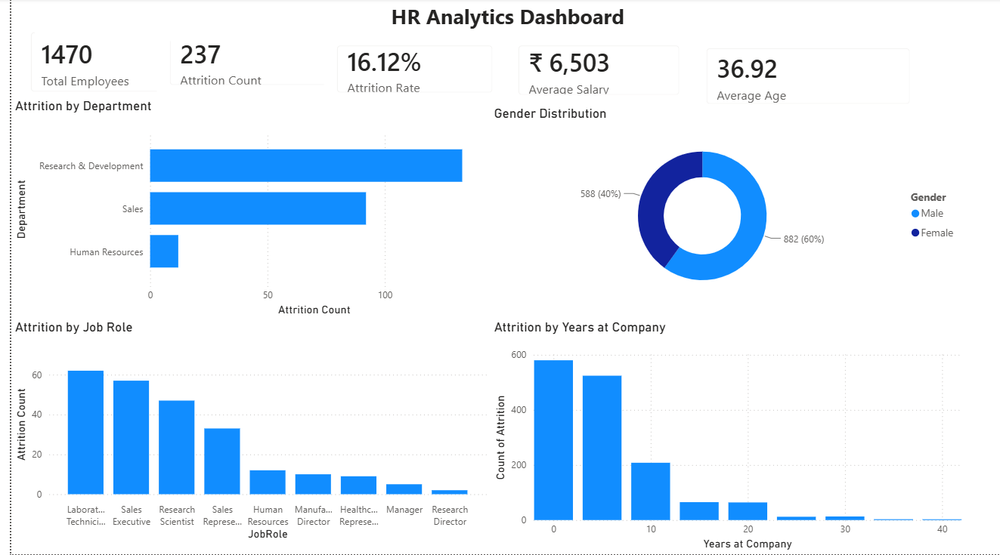
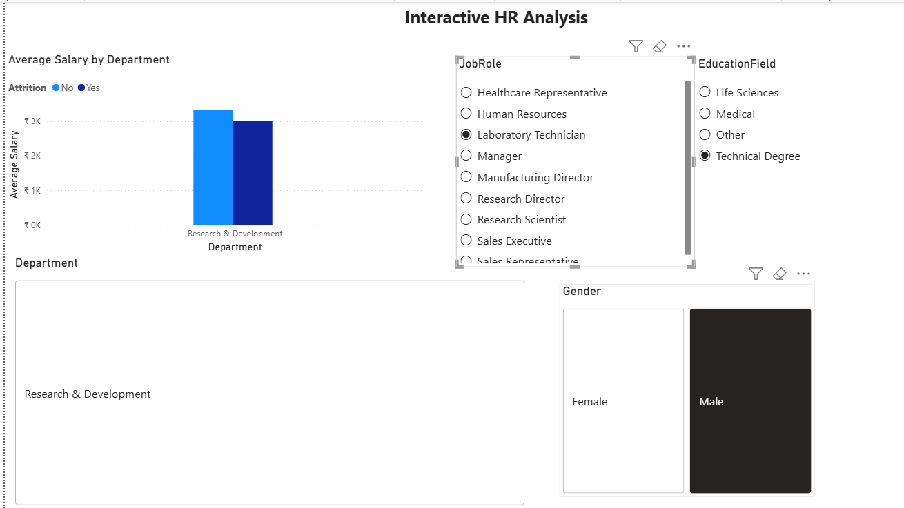

# HR Analytics Dashboard — Power BI

An interactive two-page Power BI dashboard that analyses workforce data to help HR teams monitor employee attrition, headcount trends, salary distribution, and departmental performance — enabling data-driven decisions around talent retention.

---

## Dashboard Screenshots

### Page 1 — HR Analytics Dashboard


### Page 2 — Interactive HR Analysis


---

## Problem Statement

High employee attrition is costly and disruptive. HR teams often lack a consolidated view of workforce metrics, making it hard to identify at-risk segments early. This dashboard centralises key HR data so leadership can:

- Identify departments and job roles with the highest attrition counts
- Understand gender distribution and age profiles across the workforce
- Analyse how tenure (years at company) correlates with attrition
- Drill into salary differences between employees who stayed vs. left, filtered by role, education field, department, and gender

---

## Tools & Technologies

| Tool | Purpose |
|---|---|
| **Power BI Desktop** | Data modelling, DAX measures, report authoring |
| **DAX** | Calculated columns, KPI measures, dynamic filtering |
| **Power Query (M)** | Data cleaning and transformation |
| **Excel / CSV** | Source dataset |

---

## Dashboard Pages & Features

### Page 1 — HR Analytics Dashboard
- **KPI Cards** — Total Employees, Attrition Count, Attrition Rate, Average Salary, Average Age
- **Attrition by Department** — horizontal bar chart comparing R&D, Sales, and HR
- **Gender Distribution** — donut chart showing Male/Female split
- **Attrition by Job Role** — bar chart ranked by attrition count across all job roles
- **Attrition by Years at Company** — histogram showing when employees are most likely to leave

### Page 2 — Interactive HR Analysis
- **Average Salary by Department** — grouped bar chart comparing retained vs. attrited employees
- **JobRole slicer** — filter entire page by specific job role
- **EducationField slicer** — filter by education background
- **Department slicer** — isolate a single department
- **Gender slicer** — compare male vs. female workforce segments

---

## Key KPIs

| KPI | Value |
|---|---|
| Total Employees | 1,470 |
| Attrition Count | 237 |
| Attrition Rate | 16.12% |
| Average Salary | ₹ 6,503 |
| Average Age | 36.92 years |
| Highest Attrition Dept. | Research & Development |
| Highest Attrition Role | Laboratory Technician |
| Gender Split | 60% Male · 40% Female |

---

## Dataset Description

The dashboard uses the IBM HR Analytics Employee Attrition & Performance dataset (publicly available), which contains anonymised records for **1,470 employees** across the following fields:

- Demographics: age, gender, marital status, education field, distance from home
- Job details: department, job role, job level, business travel
- Compensation: monthly income, salary hike %, stock option level
- Engagement: job satisfaction, environment satisfaction, work-life balance, relationship satisfaction
- Attrition: binary flag indicating whether the employee left

No personally identifiable information (PII) is present in this dataset.

---

## How to Open the Dashboard

1. Download and install [Power BI Desktop](https://powerbi.microsoft.com/desktop/) (free).
2. Clone or download this repository.
3. Open **`HR_Analytics_Dashboard.pbix`** in Power BI Desktop.
4. All data is embedded — no external data source connection is required.
5. Use the slicers on Page 2 to filter by Job Role, Education Field, Department, and Gender.

---

## Repository Structure

```
HR-Analytics-PowerBI/
├── HR_Analytics_Dashboard.pbix   # Power BI report file (data embedded)
├── screenshots/
│   ├── dashboard_page1.png       # HR Analytics Dashboard overview
│   └── dashboard_page2.png       # Interactive HR Analysis page
├── .gitignore                    # Excludes cache, temp, and credential files
└── README.md                     # Project documentation
```

---

## Author

**Saketh Reddy**
[GitHub](https://github.com/Saketh-1410)
